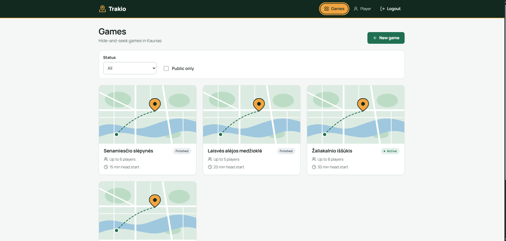
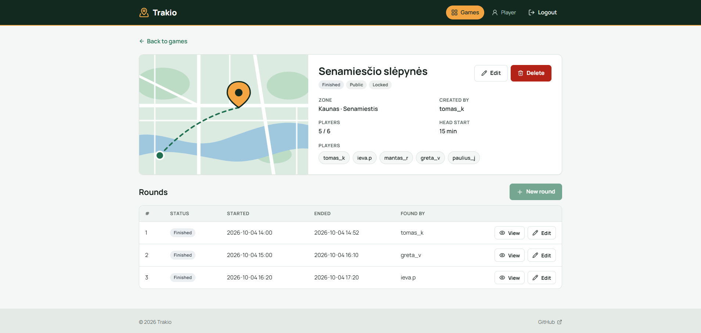
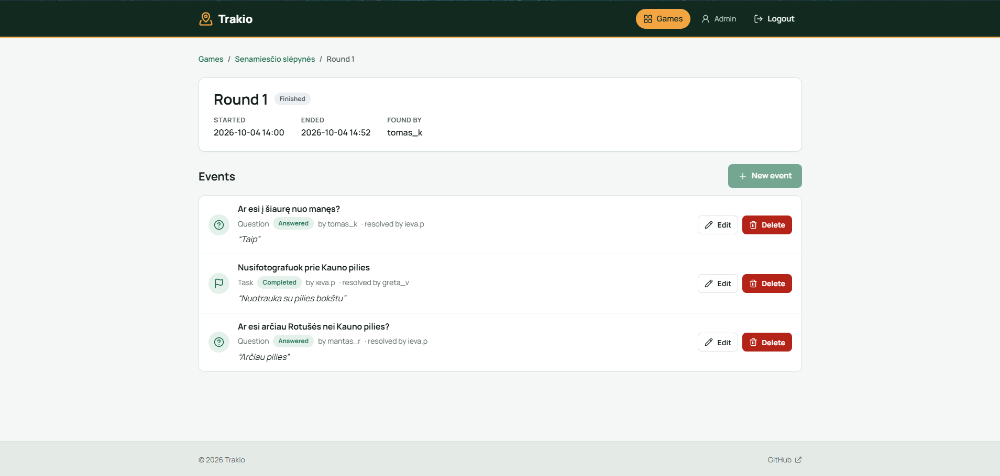
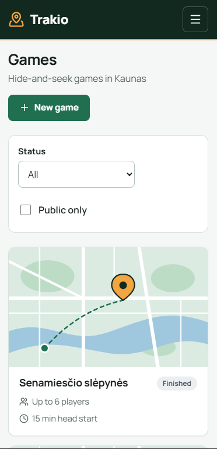
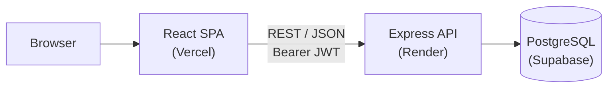

# Trakio
<<<<<<< HEAD
 
The project's goal is to create a real-time, location-based hide-and-seek game in which players compete in a real urban environment using GPS technology.
 
**How it works** – The system consists of two parts: a web application, used by both players and the administrator, and an application programming interface (API). A registered user can create a game, becoming its creator – choosing the game zone, game duration, and other parameters, then inviting other players to join the game. During the game, one or more players hide within the boundaries of the selected zone, while the remaining players search for them based on the hiding players' answers to geographic questions. Hiding players also have the option to add variety to the game and make the search more difficult for the seekers by giving them various tasks. Once a player is found, another player hides – the winner is the one with the longest single hiding time. Based on real GPS coordinates, the system automatically verifies the correctness of answers and task completion, and determines when a seeker gets close enough to a hiding player for the final phase of the game to begin. The system administrator creates game zones and their objects, questions, and tasks, and manages system users.

Prisijungimai:

Žaidėjas:

tomas@trakio.lt
Trakio123!

Administratorius:

admin@trakio.lt
Trakio123!
=======

A web app for organizing real-world hide-and-seek games in a city: one player hides inside a zone, the others track them down with questions and tasks.
Built as a full-stack semester project for the KTU module *Web Application Design*.

**[Live demo](https://trakio-kohl.vercel.app/)** · **[API spec (OpenAPI)](docs/api-spec.yaml)** · **[Course report (LT)](docs/ataskaita.md)**



## Live demo

| | |
|---|---|
| App | https://trakio-kohl.vercel.app/ |
| API health check | https://trakio-we64.onrender.com/health |
| Player login | `tomas@trakio.lt` / `Trakio123!` |
| Admin login | `admin@trakio.lt` / `Trakio123!` |

You can also register your own account. The admin can edit and delete everyone's games, rounds and events; a player only their own.

> **Cold start:** the API runs on Render's free tier and sleeps after 15 minutes without traffic. The first request after that can take about a minute.

## How the game works

A player creates a game: picks a zone (e.g. Kaunas Old Town), the maximum number of players, the hiders' head start and whether the game is public.
The game is played in rounds. During an active round, players log **events**: questions ("Are you north of me?") and tasks ("Take a photo next to Kaunas Castle"), picked from zone-specific or general templates, each with a status and an answer.

```
Game → Round → Event
```

## Features

- REST API with 21 endpoints: auth, games, rounds, events, zones, event templates.
- Three roles: guest (browse), player (manage own games), admin (manage everything).
- Games list with status and visibility filters and pagination.
- Game and round pages with create, edit and delete in modals, and toast notifications.
- Responsive layout with a mobile menu.

| Game details | Round with events | Mobile |
|---|---|---|
|  |  |  |

## Tech stack

| Layer | Tech | Hosting |
|---|---|---|
| Frontend | React 19, Vite, React Router, Axios | Vercel |
| Backend | Node.js, Express 5, Zod, JWT, bcrypt, node-postgres | Render |
| Database | PostgreSQL | Supabase |

No ORM: all queries are hand-written, parameterized SQL.
Frontend tests: Vitest and React Testing Library. API tests: a [Postman collection](backend/tests/Trakio.postman_collection.json).

## Architecture



The backend is split into routes → controllers → services, with validation (Zod schemas), authentication and authorization as separate middleware.

## Engineering highlights

### Auth with refresh-token rotation
Login returns a short-lived access JWT (15 min) and a random refresh token (7 days). Only the refresh token's SHA-256 hash is stored. Each refresh revokes the old token and issues a new pair, and logout revokes it. Blocked users can't log in or refresh.
On the frontend, an Axios interceptor catches a `401`, refreshes once and retries the request. Parallel requests share a single refresh call instead of each starting their own.

### Business rules enforced by the database
- Only one active round per game: a partial unique index (`WHERE status = 'active'`), so the rule holds even under concurrent requests.
- A round can't end before it starts, player limits stay between 2 and 20: `CHECK` constraints.
- Emails are unique among active users only, so a deleted account frees its email.

The error handler maps PostgreSQL error codes to HTTP responses (`409` for unique violations, `422` for constraint and foreign-key violations), so the API never leaks raw database errors.

### REST design
Rounds and events are nested under their parent (`GET /games/1/rounds/2/events`). The games list supports pagination and filters, responses include hypermedia `_links`, and every error has the same JSON shape (`{ error, details? }`). The whole API is documented in [OpenAPI 3.0](docs/api-spec.yaml).

## Tests

`npm test` in `frontend/` runs 12 tests:

- **Token refresh** (`client.test.js`): a `401` triggers a refresh and a retry, three parallel `401`s share one refresh call, a failed refresh clears the tokens, and `/auth/` requests are never retried.
- **Route guard** (`RequireAuth.test.jsx`): a guest is redirected to the login page.
- **Login** (`LoginPage.test.jsx`): a successful login opens the games list, and a failed one shows the server's error.
- **Game form** (`GameForm.test.jsx`): the request body is built correctly for create and edit, and API validation errors are shown.

## Running locally

**Prerequisites:** Node.js with npm, PostgreSQL.

**1. Database**

```sh
createdb trakio
psql -d trakio -f backend/db/schema.sql
psql -d trakio -f backend/db/seed.sql     # zones, templates, demo users and games
```

**2. Backend** (from `backend/`)

```sh
npm install
cp .env.example .env    # DATABASE_URL, JWT_ACCESS_SECRET, PORT
npm run dev             # http://localhost:3000
```

**3. Frontend** (from `frontend/`)

```sh
npm install
cp .env.example .env.local    # VITE_API_URL=http://localhost:3000
npm run dev
npm test
```

## How it was built

I wrote almost all of the application code myself. The CSS was mostly generated with AI, and I reviewed it. The frontend tests were also written with AI help.

## Documentation

- [docs/api-spec.yaml](docs/api-spec.yaml): OpenAPI 3.0 spec (open it in [Swagger Editor](https://editor.swagger.io/)).
- [docs/ataskaita.md](docs/ataskaita.md): course report in Lithuanian, with requirements, deployment diagram, wireframes next to the final screens, and request/response examples for every endpoint.
- [docs/wireframes/](docs/wireframes/): low-fidelity wireframes drawn before implementation.
>>>>>>> 0599a4f (Updated README, added frontend tests)
